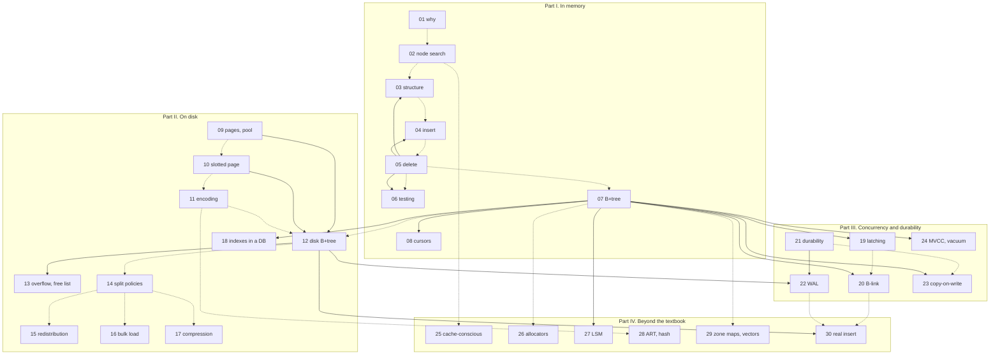

# Understanding B-trees, from simple to complex

A guide in 30 chapters that starts at "what is a sorted array" and ends at "how Postgres
splits a page while other backends are reading it". Every chapter explains one idea in
prose, implements it twice (Zig and Rust, standard library only), and shows it in an
interactive visualization that runs from the file system.

Open [index.html](index.html) in a browser for the visual table of contents, or keep
reading here.

## Contents of this file

- [Who this is for](#who-this-is-for)
- [Prerequisites](#prerequisites)
- [How a chapter is organised](#how-a-chapter-is-organised)
- [The six codebases and their honest roles](#the-six-codebases-and-their-honest-roles)
- [Table of contents](#table-of-contents)
- [Chapter dependencies](#chapter-dependencies)
- [Three reading paths](#three-reading-paths)
- [How to run everything](#how-to-run-everything)
- [Zig allocator index](#zig-allocator-index)
- [Reference documents](#reference-documents)
- [Known limitations](#known-limitations)

## Who this is for

- Programmers who use databases and want to know what an index does on disk, in enough
  detail to read the source of a real engine afterwards.
- People who know the textbook B-tree and want the parts the textbook leaves out: byte
  based fullness, split-point choice, concurrency without lock coupling, crash recovery,
  vacuum.
- People learning Zig or Rust who want a long, connected example in which memory
  management matters. Each chapter features the allocator that fits its problem and says
  why (see the [allocator index](#zig-allocator-index)).

It is not a reference manual for any one database, and the code is not a library.

## Prerequisites

- You can read code with arrays, structs and pointers in some systems language. Zig and
  Rust are explained where they differ; [ZIG_CHEATSHEET.md](ZIG_CHEATSHEET.md) covers the
  Zig 0.17.1 standard library, which changed a lot from earlier versions (I/O,
  containers, allocators, threads).
- You know what binary search does and what O(log n) means.
- No B-tree knowledge is assumed. Chapter 01 builds none; it explains the problem.
- For Part III it helps to have used a mutex once. For Part II nothing beyond "a file is
  a sequence of bytes".

To run the code you need Zig 0.17.1 and Rust 1.97 (edition 2024). To read the guide you
need only a browser and a Markdown viewer.

## How a chapter is organised

```
chapters/NN-slug/
  README.md             the chapter text
  solutions.md          worked solutions to the exercises
  expected_output.txt   exact stdout of both programs
  zig/                  build.zig, build.zig.zon, src/*.zig
  rust/                 Cargo.toml, src/*.rs
  viz/                  index.html (+ extra pages), code.js
```

The text follows one order in every chapter:

1. What you will learn, and the prerequisites.
2. The idea in plain words.
3. A worked example by hand.
4. Code walk-through: Zig first, then Rust, with the differences explained.
5. "In real databases": what the studied engines do, with `file:line` references.
   Anything not checked in source is labelled textbook or unverified.
6. Allocator notes: which allocator, which lifetime, what would go wrong with another.
7. Pitfalls.
8. Three to five graded exercises (solutions in `solutions.md`).
9. Links to the neighbouring chapters and the visualization.

Rules that hold across the guide:

- **A chapter is self-contained.** It never imports another chapter's code. When it needs
  an earlier structure it carries a copy in `src/base_*.zig` / `src/base_*.rs` with a
  "Copied from" header. You can build any chapter alone.
- **Both programs print the same text.** `zig build run` and `cargo run` print exactly
  `expected_output.txt`; a test in each language checks it.
- **Randomness is shared.** Tests in both languages use the same SplitMix64 streams from
  [common/](common/README.md), so a seed means the same operations in Zig and in Rust.
- **Counts, not timings.** The text quotes page reads, comparisons and block writes,
  never seconds.
- **"Order" M is the maximum number of children** (Knuth). A node holds at most M - 1
  keys. Examples use M = 4, a 2-3-4 tree. Chapter 03 has the table that maps this to the
  other definitions.
- **One hand example** runs through chapters 03 to 08: insert
  10, 20, 5, 6, 12, 30, 7, 17, 3, 25, 1, 15 with M = 4.
- Part I uses `u64` keys and values. The on-disk chapters use byte-string keys and
  4096-byte pages.

## The six codebases and their honest roles

The guide is grounded in six checkouts under `db_study/` (next to this directory; they
are not part of the guide and the code does not need them). Only two contain a B-tree
that a database stores its data in. The other four are here for contrast and for
techniques, and the chapters say so each time.

| Codebase | Has a B-tree? | What the guide takes from it |
|---|---|---|
| Postgres (`nbtree`) | **Yes.** On disk, concurrent (a B-link tree) | The main reference: splits and split-point choice, suffix truncation, deduplication, vacuum and page deletion, WAL records |
| Turso (SQLite format) | **Yes.** On disk, single writer | Slotted pages, table B+tree versus index B-tree, balancing over up to three siblings, page-stack cursors, pager, WAL frames, resumable state machines |
| Milvus | Only two small in-memory uses of `google/btree`; nothing on disk | A sorted-array scalar index, galloping search, segments that are LSM-like (not a true LSM) |
| DuckDB | **No.** | Contrast: ART index, zone maps, slab allocator with handles, alternating headers |
| TigerBeetle | **No.** It is an LSM forest | Contrast and technique: static two-level table index, segmented array with a node pool, in-node search, fuzzing style, static allocation |
| FAISS | **No.** | Contrast: IVF and HNSW show why an ordered tree fails for vector similarity; layout lessons |

If you read the source of only two, read Postgres for concurrency and Turso for the page
format. [SOURCE_READING_MAP.md](SOURCE_READING_MAP.md) gives the files, the order and the
pinned commits; [research/](research/) holds the notes the chapters cite.

## Table of contents

Every row links the chapter text and every visualization page of that chapter.

### Part I. In memory

Keys and values are u64. From the cost model to a complete, tested B-tree and B+tree.

| # | Chapter | What it teaches | Visualization |
|---|---|---|---|
| 01 | [Why B-trees](chapters/01-why-btrees/README.md) | The cost model indexes are designed for (count page reads, not comparisons), why the sorted array and the binary search tree each fail at half of the job, and how fan-out and height fix it. Builds no B-tree yet. | [Page-read race and fan-out](chapters/01-why-btrees/viz/index.html) |
| 02 | [Searching a sorted node](chapters/02-searching-a-sorted-node/README.md) | Lower bound and upper bound derived from a loop invariant, the insertion-index result, ranges as two bound calls, the classic off-by-one traps, and galloping search. | [Lower and upper bound, step by step](chapters/02-searching-a-sorted-node/viz/index.html) |
| 03 | [B-tree structure and search](chapters/03-btree-structure-and-search/README.md) | The definition as six invariants, the three meanings of "order", 2-3-4 trees and red-black trees, the height bound with its proof, get, in-order traversal and a first validate. Trees are built by hand. | [Search descent and invariants](chapters/03-btree-structure-and-search/viz/index.html) |
| 04 | [Insertion and splitting](chapters/04-insertion-and-splitting/README.md) | put into a leaf, the split and its promoted key, growth only at the root, what an insert costs, measured node fill, textbook top-down splitting, and reserve-then-change so that running out of memory cannot corrupt the tree. | [Interactive insert](chapters/04-insertion-and-splitting/viz/index.html)<br>[How full do the nodes get?](chapters/04-insertion-and-splitting/viz/fill.html) |
| 05 | [Deletion and rebalancing](chapters/05-deletion-and-rebalancing/README.md) | The four repairs (predecessor, borrow, merge, root shrink), why an underflow travels up, and what real engines do instead. Its code is the complete in-memory B-tree of Part I. | [Borrow, merge, shrink](chapters/05-deletion-and-rebalancing/viz/index.html) |
| 06 | [Testing a B-tree](chapters/06-testing-a-btree/README.md) | Invariants as code, a model-based fuzzer against an oracle, tiny nodes and swarm testing, asserted coverage counters, three deliberately broken trees, minimising a failing run, and fault injection. | [Fuzzer replay](chapters/06-testing-a-btree/viz/index.html) |
| 07 | [B+trees](chapters/07-bplus-trees/README.md) | Values only in the leaves, copy-up versus push-up, the doubly linked leaf chain, duplicates through a tie-breaker, and nodes addressed by 32-bit handles into one array. Seven later chapters copy this code. | [B-tree and B+tree side by side](chapters/07-bplus-trees/viz/index.html) |
| 08 | [Range scans and cursors](chapters/08-range-scans-and-cursors/README.md) | Seek, step, stop; the bounds matrix; a prefix scan as a range; two cursor designs (leaf links, root-to-leaf stack); and re-seeking by saved key when the tree changes under a cursor. | [Two cursors, one scan](chapters/08-range-scans-and-cursors/viz/index.html) |

### Part II. On disk

Byte-string keys, 4096-byte pages, a file. The tree becomes a storage engine.

| # | Chapter | What it teaches | Visualization |
|---|---|---|---|
| 09 | [Pages and the buffer pool](chapters/09-pages-and-the-buffer-pool/README.md) | A file as an array of fixed pages, a page id as a pointer that survives a restart, frames, the page table, pin counts, dirty flags and CLOCK eviction. No B-tree code. | [Frames, pins and the clock hand](chapters/09-pages-and-the-buffer-pool/viz/index.html) |
| 10 | [Slotted pages](chapters/10-slotted-pages/README.md) | Variable-size records kept sorted inside one fixed page: slot array, cell area, the three places free space hides, hole reuse and compaction, with the Turso and Postgres layouts side by side. | [Insert, delete, compact](chapters/10-slotted-pages/viz/index.html) |
| 11 | [Key and record encoding](chapters/11-key-and-record-encoding/README.md) | Varints and records, comparator keys versus byte-comparable keys, and order-preserving encodings for integers, floats, strings, composite keys, NULLs and descending columns. | [Bytes that sort like values](chapters/11-key-and-record-encoding/viz/index.html) |
| 12 | [A disk-backed B+tree](chapters/12-disk-backed-bplus-tree/README.md) | The chapter 07 tree with slotted pages as nodes and page ids as pointers: fullness in bytes, a stable root page, a metapage, and a demonstration that it is not crash-safe yet. | [Tree of pages](chapters/12-disk-backed-bplus-tree/viz/index.html)<br>[The buffer pool during a split](chapters/12-disk-backed-bplus-tree/viz/pool.html) |
| 13 | [Overflow and free space](chapters/13-overflow-and-free-space/README.md) | Values larger than a page in overflow chains, delete that frees a leaf when it is empty, an on-disk free list of trunk pages, and when a freed page may be reused in four systems. | [Overflow chain and free list](chapters/13-overflow-and-free-space/viz/index.html) |
| 14 | [Split policies and fill factor](chapters/14-split-policies-and-fill-factor/README.md) | Where to cut a full page: the middle, the rightmost-page rule, fill factor, runs of equal keys, and the decision procedure of Postgres nbtsplitloc.c on a small in-memory page model. | [Policies and fill histogram](chapters/14-split-policies-and-fill-factor/viz/index.html) |
| 15 | [Redistribution and merge policies](chapters/15-redistribution-and-merge-policies/README.md) | Repairing a page by flattening up to three siblings and cutting again (split, borrow and merge as one routine), the append fast path, and four merge policies compared by pages and churn. | [Balancing three siblings](chapters/15-redistribution-and-merge-policies/viz/index.html)<br>[Policies compared](chapters/15-redistribution-and-merge-policies/viz/policies.html) |
| 16 | [Bulk loading](chapters/16-bulk-loading/README.md) | Building a B+tree bottom-up from sorted input with one open page per level, no split and no search; what a fill factor buys; the cost against one-by-one inserts in counted pages. | [Leaves fill, parents grow](chapters/16-bulk-loading/viz/index.html) |
| 17 | [Key compression and deduplication](chapters/17-key-compression-and-deduplication/README.md) | Suffix truncation of separators, searching with shortened separators, fence keys, the row address as tie-breaker, posting lists, and the measured effect on fan-out and height. | [Truncation and posting lists](chapters/17-key-compression-and-deduplication/viz/index.html) |
| 18 | [Indexes in a database](chapters/18-indexes-in-a-database/README.md) | What goes into key and value to make a table and an index: clustered versus heap plus index, the cost of going back to the row, unique checks, covering scans and composite-key prefix scans. | [Secondary index lookup, two layouts](chapters/18-indexes-in-a-database/viz/index.html) |

### Part III. Concurrency and durability

Several threads in one tree, and a tree that survives a power cut.

| # | Chapter | What it teaches | Visualization |
|---|---|---|---|
| 19 | [Latching and lock coupling](chapters/19-latching-and-lock-coupling/README.md) | Latch versus lock; one mutex, one reader-writer lock, then a latch per node with latch coupling; the safe-node rule, latch order, convoys and deterministic concurrency tests. Optimistic descent is prose and visualization only. | [Two threads, shared and exclusive latches](chapters/19-latching-and-lock-coupling/viz/index.html) |
| 20 | [B-link trees](chapters/20-blink-trees/README.md) | Lehman and Yao: the high key and the right link, "move right", one latch at a time, a split as two atomic steps, and the incomplete-split flag that the next writer finishes. | [A search meets a half-finished split](chapters/20-blink-trees/viz/index.html) |
| 21 | [Durability primitives](chapters/21-durability-primitives/README.md) | What write and fsync promise, torn writes, page checksums (detection, not repair), the double write, and a simulated disk with seeded crashes. | [Pending and durable writes, with a crash button](chapters/21-durability-primitives/viz/index.html) |
| 22 | [WAL and crash recovery](chapters/22-wal-and-crash-recovery/README.md) | The write-ahead rule, LSN, commit, checkpoint and redo; a full-page-image log that makes a multi-page split atomic; a checksum chain that finds the end of the log; a crash after every single write. | [A split torn without a log](chapters/22-wal-and-crash-recovery/viz/index.html)<br>[The log timeline and recovery](chapters/22-wal-and-crash-recovery/viz/log.html) |
| 23 | [Copy-on-write B-trees](chapters/23-copy-on-write-btrees/README.md) | Path copying, the root flip through a two-slot checksummed metapage, snapshots, the pending-free list, and why a copy-on-write tree cannot have leaf sibling links. | [Path copying and shared subtrees](chapters/23-copy-on-write-btrees/viz/index.html) |
| 24 | [MVCC, vacuum and page deletion](chapters/24-mvcc-vacuum-and-page-deletion/README.md) | Transaction ids, row versions and snapshots; dead index entries cleaned in layers; two-phase deletion of an empty page and the rule for recycling it; and the design that keeps versions outside the tree. | [Dead entries, vacuum, recycle](chapters/24-mvcc-vacuum-and-page-deletion/viz/index.html) |

### Part IV. Beyond the textbook

Hardware, memory, and the structures that are not B-trees.

| # | Chapter | What it teaches | Visualization |
|---|---|---|---|
| 25 | [Cache-conscious search and layout](chapters/25-cache-conscious-search-and-layout/README.md) | Why binary search is slow on modern CPUs, the branchless halving search, prefetch, a SIMD scan of a small node, the Eytzinger layout and block tree, and struct-of-arrays nodes, all measured in counts. | [Cache lines touched per algorithm](chapters/25-cache-conscious-search-and-layout/viz/index.html) |
| 26 | [Allocators, handles and static memory](chapters/26-allocators-handles-and-static-memory/README.md) | A bitmap slab with 32-bit handles, size classes, vacuum, memory frozen after start-up, a buddy allocator, and a tested tour of every allocator in the Zig 0.17.1 standard library. | [Slabs and handles](chapters/26-allocators-handles-and-static-memory/viz/index.html)<br>[The buddy allocator](chapters/26-allocators-handles-and-static-memory/viz/buddy.html) |
| 27 | [B-tree vs LSM-tree](chapters/27-btree-vs-lsm/README.md) | Memtable, sorted runs, levels, compaction and tombstones; write, read and space amplification measured by counting blocks; growth factor and Bloom filters; B-epsilon trees as the midpoint. | [Same workload, two structures](chapters/27-btree-vs-lsm/viz/index.html)<br>[A buffered (B-epsilon) node](chapters/27-btree-vs-lsm/viz/bepsilon.html) |
| 28 | [Radix trees and hash indexes](chapters/28-radix-trees-and-hash-indexes/README.md) | The adaptive radix tree (four node layouts, path compression, ordered iteration), a hash index with linear probing, and which questions each structure can answer. | [An ART node grows](chapters/28-radix-trees-and-hash-indexes/viz/index.html) |
| 29 | [Zone maps and vector indexes](chapters/29-zone-maps-and-vector-indexes/README.md) | Min/max summaries that prune without order, why no sort order keeps near vectors near, IVF with nprobe and recall, and HNSW in outline (prose and visualization only). | [Zone-map pruning](chapters/29-zone-maps-and-vector-indexes/viz/index.html)<br>[IVF probing](chapters/29-zone-maps-and-vector-indexes/viz/ivf.html)<br>[Greedy graph descent](chapters/29-zone-maps-and-vector-indexes/viz/hnsw.html) |
| 30 | [Tracing a real insert](chapters/30-tracing-a-real-insert/README.md) | The capstone: one INSERT followed through Postgres nbtree and through Turso with a file and line for every step, and the blocking put of chapter 12 rewritten as a resumable state machine. | [Two swim lanes, one insert](chapters/30-tracing-a-real-insert/viz/index.html) |

## Chapter dependencies

Two different relations are worth telling apart.

- **Reading order** (dotted arrows): what the chapter's own "Prerequisites" paragraph
  names.
- **Code copies** (solid arrows): the chapter's `base_*` files carry a "Copied from"
  header naming the source chapter. These were checked by searching the source files.

One thing may surprise you: chapters 03, 04 and 06 copy from chapter **05**. Chapter 05
holds the complete in-memory B-tree; 03 and 04 are trimmed views of it (search only,
then search and insert), so the text reads 03, 04, 05 while the code flows from 05.



The same information as a table (the diagram omits some dotted arrows to stay readable;
this table has all of them).

| Chapter | Read first (from its Prerequisites) | Copies code from |
|---|---|---|
| 01 | nothing | |
| 02 | 01 | |
| 03 | 01, 02 | 05 |
| 04 | 02, 03 | 05 |
| 05 | 02, 03, 04 | |
| 06 | 03, 04, 05 | 05 |
| 07 | 02 to 05 (06 for the testing style) | |
| 08 | 02, 07 | 07 |
| 09 | 01, 07 | |
| 10 | 02, 09 | |
| 11 | 02, 10 | |
| 12 | 07, 09, 10, 11 | 09, 10 |
| 13 | 09, 10, 12 | 12 (and through it 09, 10) |
| 14 | 04, 07, 10, 12 | |
| 15 | 05, 10, 14 | |
| 16 | 04, 07, 14 (15 helps) | |
| 17 | 07, 10, 12, 14 | |
| 18 | 07 (08 and 11 are pointed to) | 07 |
| 19 | 06, 07 | 07 |
| 20 | 07, 19 | 07 |
| 21 | 09 (12 for motivation) | |
| 22 | 12, 21 | 12, 21 (and through 12: 09, 10) |
| 23 | 07, 09, 21 | 07 |
| 24 | 07 | 07 |
| 25 | 01, 02 | |
| 26 | 03 to 05, 07 | |
| 27 | 07, 09 (16 and 26 help) | 07 |
| 28 | 02, 08, 11 | |
| 29 | 01, 02, 07 | |
| 30 | 12, 20, 22 | 12 (and through it 09, 10) |

Almost every chapter also carries copies of `common/` files (PRNG, operation stream,
CRC-32, hexdump).

## Three reading paths

### The short path: the core in a weekend

Eight chapters. You finish with a complete B-tree, a B+tree, and a clear picture of how
it lands on disk.

1. [01 Why B-trees](chapters/01-why-btrees/README.md)
2. [02 Searching a sorted node](chapters/02-searching-a-sorted-node/README.md)
3. [03 B-tree structure and search](chapters/03-btree-structure-and-search/README.md)
4. [04 Insertion and splitting](chapters/04-insertion-and-splitting/README.md)
5. [05 Deletion and rebalancing](chapters/05-deletion-and-rebalancing/README.md)
6. [07 B+trees](chapters/07-bplus-trees/README.md)
7. [10 Slotted pages](chapters/10-slotted-pages/README.md) (read the first half of
   [09](chapters/09-pages-and-the-buffer-pool/README.md) for "a file is an array of pages")
8. [12 A disk-backed B+tree](chapters/12-disk-backed-bplus-tree/README.md)

If time is short, use the visualizations of 03, 04, 05 and 07 in place of the code
walk-throughs, and come back to [06 Testing](chapters/06-testing-a-btree/README.md)
before you write a tree of your own.

### The storage-engine path

For readers who want to understand, or build, the on-disk half of a database. Do the
short path first, then:

1. [08 Range scans and cursors](chapters/08-range-scans-and-cursors/README.md)
2. [09 Pages and the buffer pool](chapters/09-pages-and-the-buffer-pool/README.md)
3. [11 Key and record encoding](chapters/11-key-and-record-encoding/README.md)
4. [13 Overflow and free space](chapters/13-overflow-and-free-space/README.md)
5. [14 Split policies](chapters/14-split-policies-and-fill-factor/README.md) and
   [15 Redistribution and merge policies](chapters/15-redistribution-and-merge-policies/README.md)
6. [16 Bulk loading](chapters/16-bulk-loading/README.md)
7. [17 Key compression and deduplication](chapters/17-key-compression-and-deduplication/README.md)
8. [18 Indexes in a database](chapters/18-indexes-in-a-database/README.md)
9. [26 Allocators, handles and static memory](chapters/26-allocators-handles-and-static-memory/README.md)
10. [27 B-tree vs LSM-tree](chapters/27-btree-vs-lsm/README.md), then
    [28](chapters/28-radix-trees-and-hash-indexes/README.md) and
    [29](chapters/29-zone-maps-and-vector-indexes/README.md) for the alternatives
11. [30 Tracing a real insert](chapters/30-tracing-a-real-insert/README.md)
    (its Postgres lane uses chapter 20; skim that chapter's "idea in plain words" first)

### The concurrency-and-durability path

For readers who know B-trees and want Part III. Minimum preparation: 07 (the tree every
chapter of Part III starts from), 09 and 12.

1. [06 Testing a B-tree](chapters/06-testing-a-btree/README.md): the oracle and
   fault-injection style used by every test in Part III
2. [19 Latching and lock coupling](chapters/19-latching-and-lock-coupling/README.md)
3. [20 B-link trees](chapters/20-blink-trees/README.md): what Postgres does instead
4. [21 Durability primitives](chapters/21-durability-primitives/README.md)
5. [22 WAL and crash recovery](chapters/22-wal-and-crash-recovery/README.md)
6. [23 Copy-on-write B-trees](chapters/23-copy-on-write-btrees/README.md): the same
   problem as 22 solved the other way
7. [24 MVCC, vacuum and page deletion](chapters/24-mvcc-vacuum-and-page-deletion/README.md)
   (read the "when may a freed page be reused" section of
   [13](chapters/13-overflow-and-free-space/README.md) alongside)
8. [30 Tracing a real insert](chapters/30-tracing-a-real-insert/README.md)

## How to run everything

Toolchain: **Zig 0.17.1** and **Rust 1.97** (edition 2024). No external dependencies in
either language; `cargo` needs no network. Node.js is needed only for the toolkit's
self-test.

One chapter:

```
cd chapters/04-insertion-and-splitting
cd zig  && zig build test && zig build run      # run prints expected_output.txt
cd ../rust && cargo test && cargo run
cargo clippy --all-targets -- -D warnings        # clean in every chapter
```

Everything, one chapter at a time:

```
./run_all_tests.sh                 # common/, the toolkit self-test, then chapters 01 to 30
./run_all_tests.sh --only 14       # one chapter (also: --only common, --only assets)
./run_all_tests.sh --no-clippy     # skip cargo clippy
./run_all_tests.sh --keep          # keep .zig-cache, zig-out and target
```

The script prints one PASS or FAIL line per step and a summary table, and exits non-zero
if any step failed. By default it deletes `.zig-cache`, `zig-out` and `target` after each
chapter, because thirty Rust `target` directories and Zig caches add up to many
gigabytes; `--keep` turns that off. Zig's global cache (`~/.cache/zig`) is not touched.
Logs of failed steps are kept in a temporary directory whose path is printed.

Chapter 26 has two extra Zig test steps for allocators that need a special build:
`zig build test-single-threaded` (enables the `BrkAllocator` example) and
`zig build test-libc` (enables the `c_allocator` example). In the default
`zig build test` those two tests report "skipped". The runner runs only the default step.

Visualizations: open any `chapters/NN-slug/viz/*.html`, or [index.html](index.html),
directly in a browser. No server, no network, no build step. They have a light and a
dark theme and work at phone width. The toolkit is described in
[assets/README.md](assets/README.md); [assets/demo.html](assets/demo.html) shows every
component, and `node assets/selftest.js` fuzzes the toolkit's reference models against an
oracle.

Mermaid diagrams in this file render on GitHub and in most Markdown viewers; the table
under the diagram carries the same information as plain text.

## Zig allocator index

Built by searching the chapters' Zig sources (`zig/src/*.zig`, copied `base_*` files
excluded) and their "Allocator notes" sections. "Featured" means the chapter's text
explains the choice; "also used" means it appears in code or tests without being the
subject. Chapter 26 has a tested example of every standard-library row.

### Standard library

| Allocator | Featured in | Why there |
|---|---|---|
| `std.heap.ArenaAllocator` | 03 | Introduced after the hand-written bump allocator: a tree built once and freed in one call |
| | 08 | Cursor path stack and materialised results; `reset(.retain_capacity)` per scan |
| | 11 | Decoded rows that die together |
| | 12, 13 | One arena per tree for per-operation scratch, reset when the operation returns |
| | 14, 15 | Scratch for one split or one balance (imaginary page, flattened cell array), reset on every exit path |
| | 16 | One arena per tree level, so loader memory is O(height) |
| | 17 | One arena per page owns every byte the page refers to |
| | 18 | One arena per query for result slices |
| | 19 | A thread-safe arena for the stress workers' logs (thread-safe when its child is) |
| | 21, 22 | Pending writes in the simulated disk; page images during recovery |
| | 23 | One arena per write transaction, dropped on abort |
| | 27 | Memtable arena, reset on flush |
| | 29 | k-means scratch inside `Ivf.build` |
| | 30 | One arena per operation that survives across resumptions |
| `std.heap.FixedBufferAllocator` | 01 | The sorted array on a stack buffer: one block, no system call |
| | 02 | Test arrays of known total size; shows the alignment trap of a `[N]u8` buffer |
| | 11 | Encode buffers |
| | 17 | Bounded scratch for the slow path of a page rebuild |
| | 21 | Exactly two sector buffers in double-write recovery |
| | 22 | Assembling log records in a buffer allocated once |
| | 30 | The deliberately wrong "per-step buffer" that shows why scratch must outlive a yield |
| | *also used:* 07, 12, 13 (tests), 26 (tour; the buddy heap sits on a fixed buffer) | |
| `std.heap.BufferFirstAllocator` | 11 | One key of unknown size: stack first, heap on overflow |
| | 13 | Assembling a value that is usually small and sometimes 60000 bytes (0.17's replacement for `stackFallback`) |
| | 26 | Tour |
| `std.heap.page_allocator` | 01 | The BST gets one page per node, so "one page read per pointer hop" is literal |
| | 26 | Tour: one `mmap` per allocation |
| | *also used:* 05, 06 (as the backing of a local `SafeAllocator`) | |
| `std.heap.smp_allocator` (`SmpAllocator`) | 19 | Backs the node tables when four threads allocate |
| | 26 | Tour |
| `std.heap.SafeAllocator` | 05 | What `std.testing.allocator` is: leaks and double frees of pool nodes fail the test |
| | 26 | Tour: the checking general-purpose allocator |
| | *also used:* 03, 04, 06 | |
| `std.heap.DebugAllocator` | 26 | Tour only: deprecated in favour of `SafeAllocator` |
| `std.heap.MemoryPool` | 04 | The node pool: every node has the same size |
| | 05 | `StdPool`, after the same thing is written by hand |
| | 18 | Fixed-size heap pages for rows |
| | 28 | One pool per ART node type (size classes) |
| | 26 | Tour, including the non-growable `memory_pool.Extra` and `memory_pool.Aligned` |
| `std.heap.brk_allocator` (`BrkAllocator`) | 26 | Tour; needs `zig build test-single-threaded` |
| `std.heap.c_allocator` | 26 | Tour; needs `zig build test-libc` |
| `std.MultiArrayList` (a container, listed for completeness) | 25 | Struct-of-arrays node: one allocation, keys contiguous |
| Aligned allocation (`alignedAlloc`) | 09, 25 | Page-aligned frames; cache-line aligned key arrays |
| `std.mem.ValidationAllocator`, `Allocator.failing` | 26 | Tour |

### Testing tools

| Tool | Where | What it is used for |
|---|---|---|
| `std.testing.allocator` | All 30 chapters | Every test: a leak or a double free fails the run. Chapter 05 explains what it is; chapter 24 uses it to prove that vacuumed pages are released; chapter 28 notes what it cannot see (a node lost inside a pool) |
| `std.testing.FailingAllocator` | Featured in 06 (compared with the hand-written wrapper); used in the tests of 27 chapters (all except 11, 25, 29) | Aim one `OutOfMemory` at one step of an insert and check that the structure is unchanged |
| `std.testing.checkAllAllocationFailures` | Featured in 04; used in 22 chapters (01, 03 to 11, 14 to 17, 20, 21, 23, 25 to 29) | Run a function once per allocation point, failing from that one on |

### Hand-written allocators

| Allocator | Chapter and file | Why it is written by hand |
|---|---|---|
| Bump allocator (`BumpAllocator`) | 03, `zig/src/bump.zig` | To see what an arena is before using `ArenaAllocator` |
| Free-list pool (`FreeListPool`) | 05, `zig/src/pool.zig` | A freed node stores the next-free pointer in its own bytes; then replaced by `MemoryPool` |
| Counting and fault-injecting wrapper (`FaultAllocator`) | 06, `zig/src/fault_alloc.zig` | Implements the `std.mem.Allocator` interface; counts, and fails on demand and repeatedly |
| Index arena with a free list (`Arena(T)`) | 07, `zig/src/arena.zig`; reused by 08, 18, 24, 27 | Nodes named by 32-bit handles into one growable array |
| Slab of page-aligned frames | 09, `zig/src/buffer_pool.zig`; reused by 12, 13, 22, 30 | All frames have one size and one lifetime; "allocating" is the CLOCK sweep; nothing allocates after `init` |
| In-page cell allocator (`allocSpace` / `freeSpace`) | 10, `zig/src/slotted_page.zig` | Returns offsets, not pointers. The chapter gives four reasons why it cannot be a `std.mem.Allocator` |
| Preallocated node table | 19, 20 | One allocation in `init`; a table that grew would move nodes under other threads |
| Bitmap slab with 32-bit handles (`SlabPool`) | 26, `zig/src/slab.zig` | One bit per slot, no per-item header, relocation and vacuum |
| Buddy allocator (`BuddyAllocator`) | 26, `zig/src/buddy.zig` | Power-of-two blocks that split and merge; supplies the slabs |
| Static, freeze-after-init allocator (`StaticAllocator`) | 26, `zig/src/static_allocator.zig` | After start-up any allocation is a detected bug |

The Rust side has no allocator parameter on stable. Each chapter shows the idiom that
replaces it: a typed arena (`Vec<Node>` with `u32` indices), a slab with a free list of
indices, a bump `Vec<u8>` with offsets, boxed page frames, "drop the Vec" as an arena,
and a node budget that returns `Err(OutOfNodes)` where Zig tests allocation failure.

## Reference documents

| File | What it is |
|---|---|
| [index.html](index.html) | Landing page: a card per chapter with links to the text and every visualization |
| [GLOSSARY.md](GLOSSARY.md) | Terms used across chapters, each with the chapter that introduces it |
| [SOURCE_READING_MAP.md](SOURCE_READING_MAP.md) | Per codebase: which files to read in which order, with line numbers, tied to chapters |
| [ZIG_CHEATSHEET.md](ZIG_CHEATSHEET.md) | Verified Zig 0.17.1 APIs used by the chapters |
| [PLAN.md](PLAN.md) | The plan the guide was written from: conventions, the per-chapter table, the review process |
| [research/](research/) | Source notes with `file:line` references: [postgres.md](research/postgres.md), [turso.md](research/turso.md), [duckdb.md](research/duckdb.md), [tigerbeetle.md](research/tigerbeetle.md), [milvus_faiss.md](research/milvus_faiss.md) |
| [common/README.md](common/README.md) | The shared PRNG, operation stream, oracle, CRC-32 and hexdump that chapters copy |
| [assets/README.md](assets/README.md) | The visualization toolkit (`viz.css`, `viz.js`) |
| [_template/CHAPTER_BRIEF.md](_template/CHAPTER_BRIEF.md) | The brief every chapter was written against, with compiling Zig and Rust skeletons |
| [run_all_tests.sh](run_all_tests.sh) | The test runner described above |

## Known limitations

**This is teaching code, not production code.** It is commented for reading, tested for
correctness against oracles, and never tuned. Do not put it under real data.

Where chapters differ from the plan or stop short, in their own words:

- **Chapter 12 is not crash-safe, on purpose**, and has no delete and a value size cap
  (a quarter page). Its last demo tears a split to show the problem.
- **Chapter 13 is less crash-safe than 12**: it reuses a freed page immediately, which
  the chapter itself calls the one answer of four that is not safe. It frees a leaf only
  when it is empty and never merges.
- **Chapters 19 and 20 have search and insert only** (chapter 20 removes delete from the
  chapter 07 tree). Optimistic descent with version counters in 19 is prose and
  visualization, not code.
- **Chapter 22's log stores full page images**, the simplest design that works. Postgres
  logs small logical records per structural step; the chapter describes that but does
  not build it.
- **Chapter 23**: neither DuckDB nor TigerBeetle is a copy-on-write B-tree; they are
  cited for copy-on-write storage. The description of LMDB is from memory and labelled
  unverified, because LMDB is not among the checkouts.
- **Chapter 24 uses no threads.** Everything "concurrent" is an interleaving of single
  steps.
- **Chapter 25 reports counts** (comparisons, cache lines touched), not timings; an
  optional `--bench` flag prints timings for your machine to stderr. Rust has no safe
  stable prefetch, so the hint is recorded, not issued.
- **Chapter 26**: two rows of the allocator tour are skipped in the default build (see
  [How to run everything](#how-to-run-everything)). UEFI allocators are not run.
- **Chapter 27's device counts blocks and stores no bytes.** The section "The counting
  model, and what it leaves out" lists what that ignores.
- **Chapter 29 implements zone maps and IVF. HNSW is prose and visualization only.**
- **Described but not implemented**: prefix compression (17) and skip scan (08).
  Top-down splitting is implemented in 04 as a textbook alternative; none of the six
  codebases uses it. Bw-trees, foster B-trees, partitioned B-trees, cache-oblivious
  layouts and key-range locking are sidebars at most.
- **Unverified statements are labelled as such** in the chapters, for example the degree
  used by Milvus's `google/btree` (03) and fence keys in the six codebases (17).
- **Rust unsafe**: all Rust is safe code except one declared exception, the counting
  `#[global_allocator]` in chapter 06.

Length. The chapter brief asked for 1500 to 3500 words of text and 250 to 800 lines of
code per language. Most chapters are longer:

- Text: 26 of 30 READMEs are over 3500 words. Only 01, 06, 12 and 29 are within the
  target. The longest are 23 (about 5800 words), 03 and 08 (about 4800), 15 and 19
  (about 4650) and 30 (about 4500).
- Code: every chapter is over 800 lines per language once tests are counted. The
  smallest Zig tree is 29 (about 1200 lines); chapters that carry copied `base_*` files
  are the largest (22 about 6500 lines of Zig of which about 4200 are copies; 13 about
  5650; 30 about 5000; 12 about 4600). Single files over 1000 lines exist in 10, 12, 13,
  22, 23, 28 and 30.
- These figures were measured when this file was written; chapters 06, 13, 19, 20, 22,
  23 and 30 were still being revised at that time.

Other things to know:

- The `file:line` references point into checkouts pinned at the commits listed in
  [SOURCE_READING_MAP.md](SOURCE_READING_MAP.md). At other commits the lines move.
- The copied `base_*` files are frozen copies. A fix in a source chapter has to be
  re-copied by hand into its dependents.
- Stress tests use at most four threads and a few seconds; they find races, they do not
  prove their absence.
- The visualizations draw small trees (order 4, tens of keys) and pages of at most 256
  bytes. Their JavaScript models are checked against the programs' printed output by a
  self-test on each page, but they are separate implementations.
- The toolkit's own limits are listed in [assets/README.md](assets/README.md), section 6.
