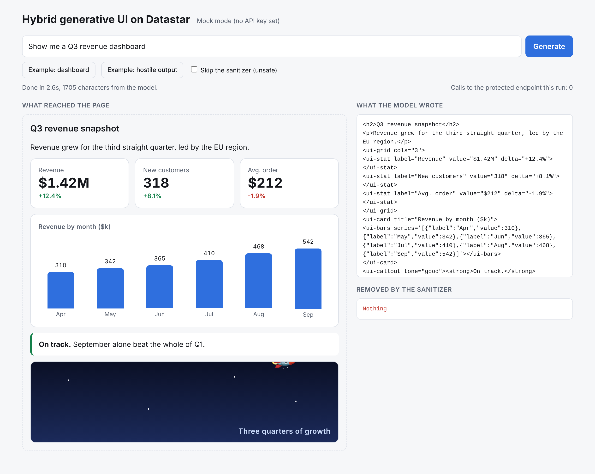

# Hybrid generative UI on Datastar

A model writes an HTML fragment, the server sanitizes it as it streams, and
Datastar patches it into the page. The model has two ways to build UI:

- **Components.** A fixed set of `<ui-*>` custom elements (stat, card, bar
  chart, grid, callout), written once as Rocket components. The model only
  fills in attributes.
- **Free-form.** A `<free-form>` block where the model writes its own HTML,
  SVG and CSS, including animations. It renders in a sandboxed iframe.



## Run it

```bash
npm install
```

```bash
npm start
```

Open http://localhost:8080. Without an API key it runs in mock mode, replaying
two canned model outputs. To use a real model, set `ANTHROPIC_API_KEY` before
`npm start`.

```bash
npm test
```

## Things to try

1. **Example: dashboard** shows components and a free-form animation
   streaming in together.
2. **Example: hostile output** replays what a prompt-injected model might
   write: a `<script>`, a `data-init` that posts to a protected endpoint, an
   inline event handler, a fake "session expired" banner. The right-hand
   panels show what the model wrote and what was removed, and the call counter
   for the protected endpoint stays at 0.
3. Tick **Skip the sanitizer** and run the hostile example again. The banner
   appears and the counter goes up.

## How it works

| File | Role |
|---|---|
| `server.mjs` | Reads the prompt from Datastar's signals, streams the model, and every 80 ms sends the sanitized text so far as one `datastar-patch-elements` event. |
| `sanitize.mjs` | The component catalogue and both allowlists. The system prompt is generated from the same catalogue. |
| `public/components.js` | The Rocket components. |
| `public/index.html` | The page: plain Datastar attributes, no other client code. |
| `mock.mjs` | The canned outputs for mock mode. |

Two rules keep the page safe:

- **Outside `<free-form>`**, only text tags and the catalogue's elements
  survive, each with a fixed list of attributes. Everything else is dropped,
  including `style`, `class`, `on*` and every `data-*` attribute, which is
  what Datastar would otherwise execute.
- **Inside `<free-form>`**, CSS is allowed but the content goes into an
  `<iframe sandbox="">` with a Content-Security-Policy of `default-src 'none'`,
  so it cannot run scripts, make network requests, or style the host page.

A free-form block appears only once it has finished streaming. Rendering it
earlier would reload the iframe and restart its animations on every chunk.

## Limits

- The free-form frame has a fixed height the model chooses (80 to 480 px). It
  cannot resize itself, because that would need a script.
- The live path against the Claude API is written but was not exercised here:
  no API key was available, so only mock mode has been run.
- `public/vendor/datastar-rocket.js` is a copy of the bundle from the Datastar
  repository (MIT, licence alongside it).
